# LiveQuiz

A real-time quiz platform in the spirit of Kahoot: a host builds a quiz, starts a session and shows a PIN; players join from
their phones, answer against a server-side clock and watch the leaderboard move. Built as a portfolio project to exercise
**Orleans, SignalR, Blazor render modes, .NET Aspire and EF Core** together, with the hard parts (timing, scoring, reconnects,
two silos) done properly rather than demoed.

- **2000 players, 10 questions, 2 silos, 0 lost events** in a k6 run on one laptop ([docs/load-test.md](docs/load-test.md)).
- Time and scoring are decided **on the server**; the browser only shows a countdown ([ADR 0005](docs/adr/0005-server-authoritative-time.md), [0011](docs/adr/0011-server-authoritative-timing-and-scoring.md)).
- A player who reloads, loses Wi-Fi or whose silo dies lands back on the same question ([ADR 0013](docs/adr/0013-restart-reconnect-and-abandon.md)).
- Vertical slices, no mediator, no generic repository ([ADR 0001](docs/adr/0001-vertical-slice-no-mediator.md)).

## Screenshots

Captured from the Compose stack with the seeded demo host.

| Home | Host sign in | Quizzes |
| --- | --- | --- |
| 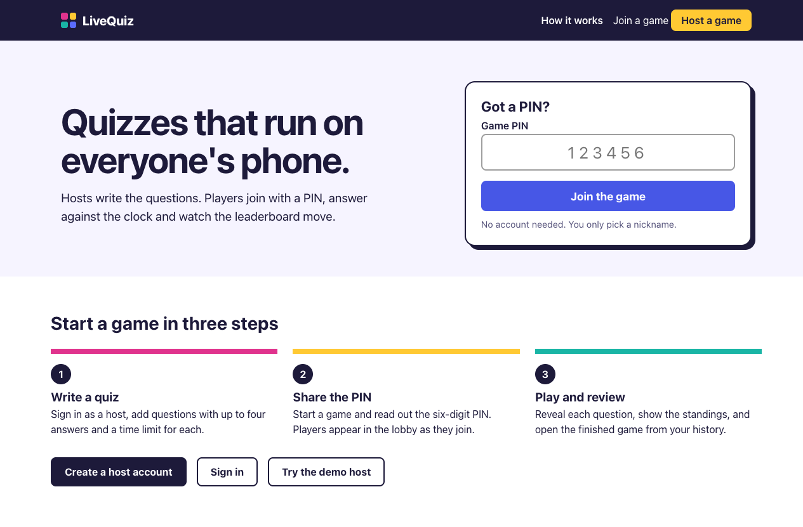 | 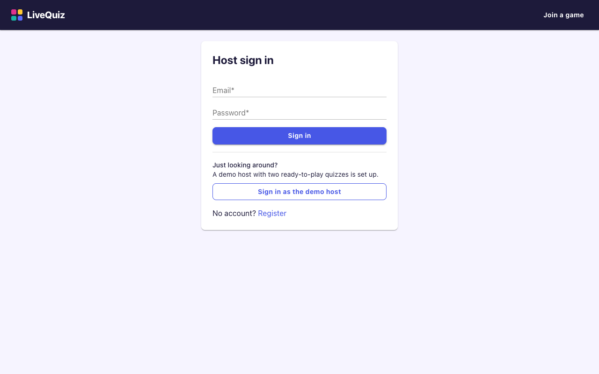 | 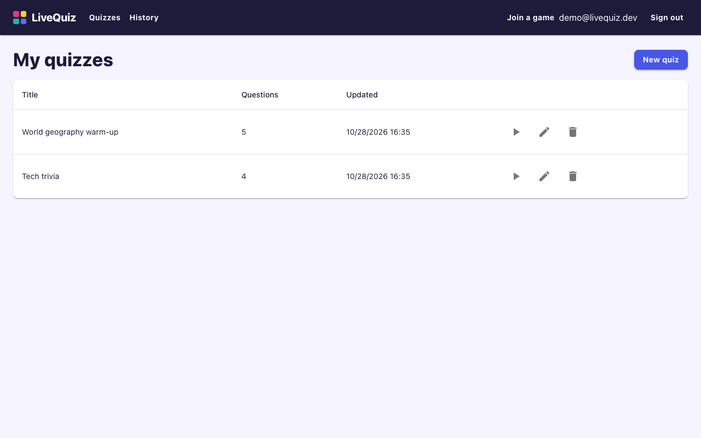 |

| Quiz editor | Host lobby | Host question |
| --- | --- | --- |
| 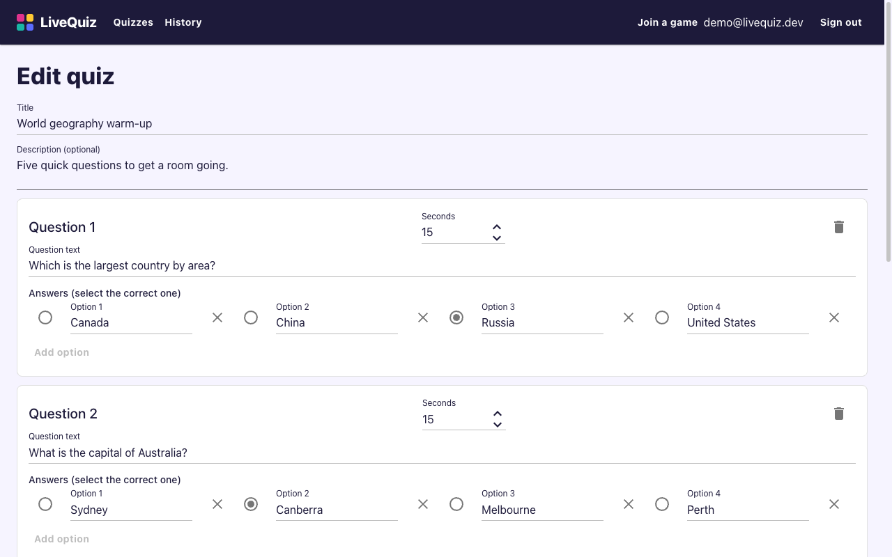 | 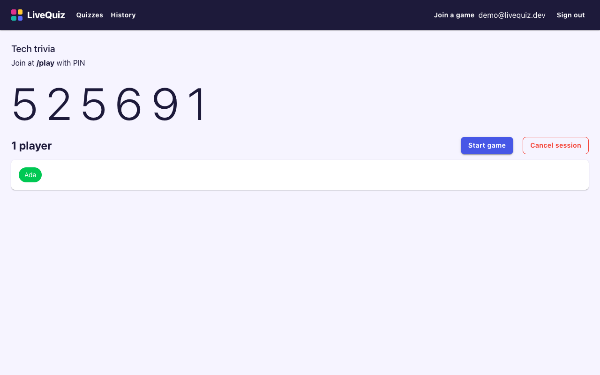 | 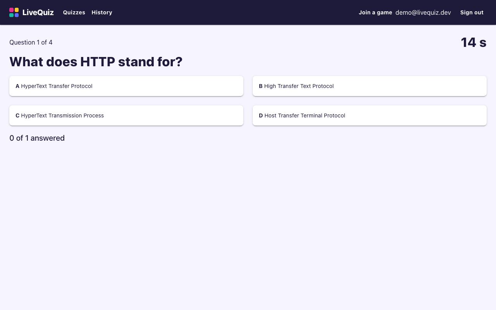 |

| Player join | Player lobby | Player question | Player result |
| --- | --- | --- | --- |
| 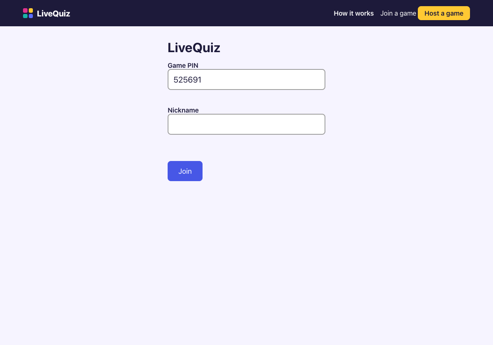 | 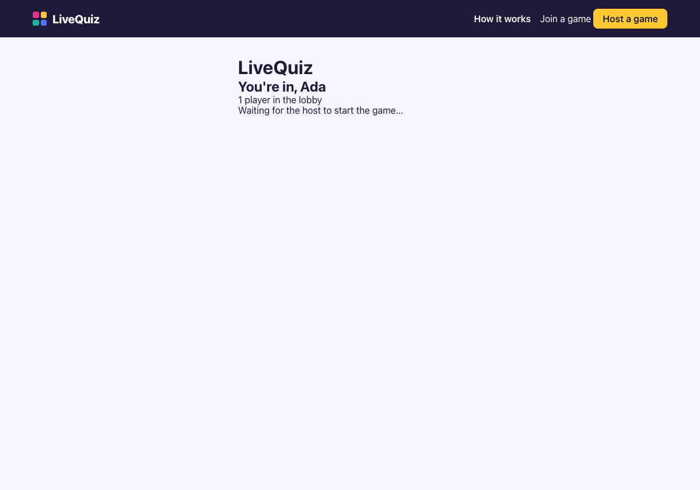 | 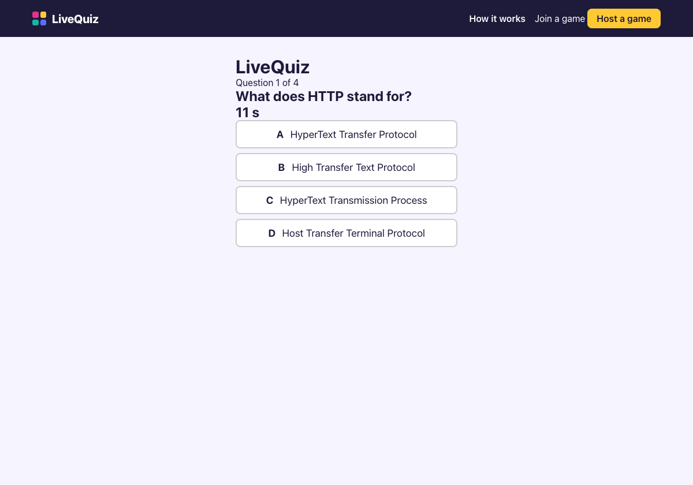 | 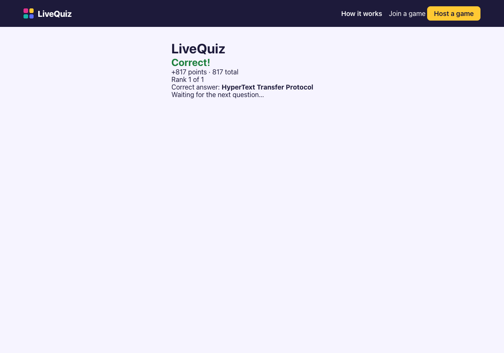 |

On a 375 px phone:

| Home | Host sign in | Quizzes | Quiz editor | Player result |
| --- | --- | --- | --- | --- |
| 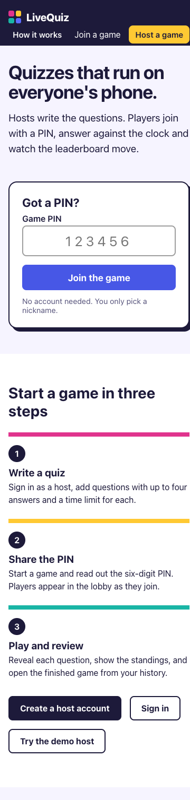 | 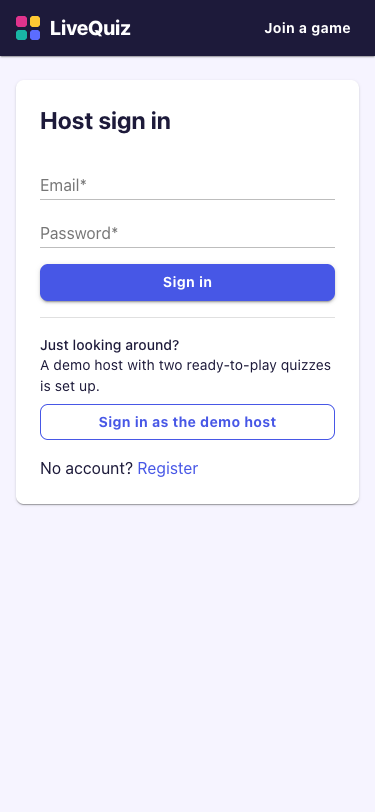 | 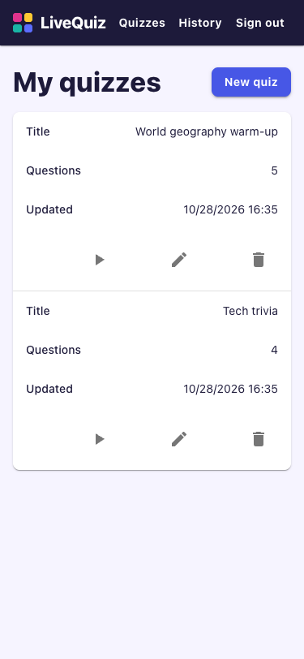 | 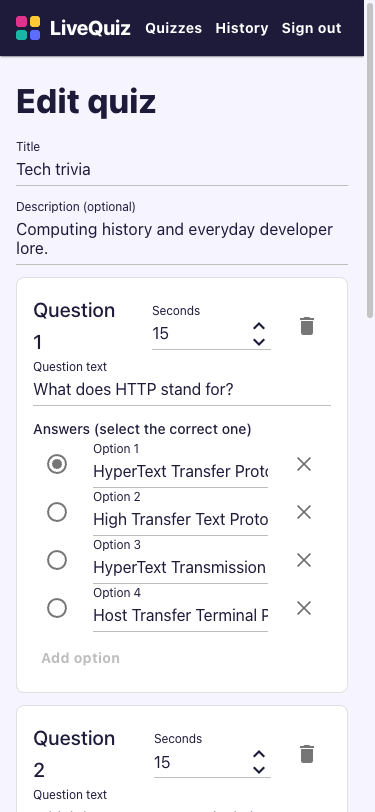 | 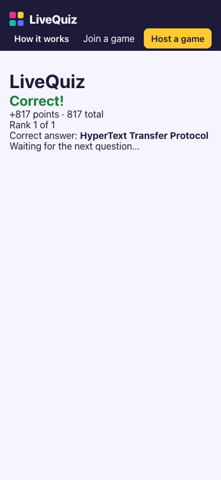 |

## Languages

The whole UI is available in English and Turkish. The `EN | TR` switch in the navbar sets a `lq-lang` cookie; without it the
browser's `Accept-Language` decides, and English is the fallback. English text is its own key, so a string without a Turkish
entry shows in English. Translations live in [Turkish.cs](src/LiveQuiz.Web.Client/Localization/Turkish.cs); the player screen
(WebAssembly) reads the language the server rendered into `<html lang>`. .NET cultures are not used because the images run with
invariant globalization.

## Architecture

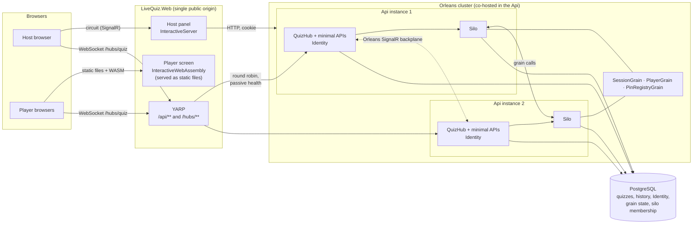

| Piece | What it does |
| --- | --- |
| `LiveQuiz.Web` | The only origin a browser talks to. Serves the Blazor app and proxies `/api/**` and `/hubs/**` to the Api with YARP, so the Identity cookie is first-party and there is no CORS ([ADR 0007](docs/adr/0007-auth-topology.md)). |
| `LiveQuiz.Web.Client` | The player screen, compiled to WebAssembly, and its SignalR client with reconnect logic. |
| `LiveQuiz.Api` | Minimal APIs (auth, quizzes, sessions), the `QuizHub`, ASP.NET Core Identity (hosts only), EF Core, and the Orleans silo ([ADR 0003](docs/adr/0003-orleans-co-hosted-in-api.md)). |
| `LiveQuiz.Grains` | `SessionGrain` (one per game: lobby, timer, scoring, state machine), `PlayerGrain` (token check), `PinRegistryGrain` (PIN to session). No Orleans types leak out of it. |
| `LiveQuiz.Contracts` | DTOs shared by browser and server. Free of Orleans and ASP.NET references. |
| `LiveQuiz.AppHost` | .NET Aspire: Postgres, two Api instances, Web, dashboard with OpenTelemetry traces, metrics and logs. |
| PostgreSQL | Quizzes, finished-game history, Identity, Orleans grain state (ADO.NET persistence) and silo membership. |

A hub call reaches whichever instance holds the socket; the Orleans SignalR backplane carries pushes between instances and
groups (`session:{id}:host`, `:players`, `:player:{id}`) hold the audience ([ADR 0009](docs/adr/0009-grain-to-hub-push.md), [0015](docs/adr/0015-signalr-backplane.md)).

### Why two render modes

| | Host panel | Player screen |
| --- | --- | --- |
| Render mode | `InteractiveServer` | `InteractiveWebAssembly` (no prerender) |
| Who and how many | One authenticated host per game | Hundreds or thousands of anonymous phones per game |
| Cost of the mode | One circuit and its server memory per host | A one-off runtime download per phone; **nothing held on the server per player** |
| Why this one | Cookie and identity are already on the server, no WASM download for a desk tool, direct access to server services | 2000 players would be 2000 circuits (memory, a sticky connection each); in WASM the server only holds a WebSocket to the hub, which is what the backplane scales |

The rule is that a mode is chosen per page by who uses it and how many of them there are ([ADR 0004](docs/adr/0004-blazor-render-modes.md)).
An E2E test asserts it: the host panel never downloads the .NET runtime, the player screen does.

## Run it

Requires the .NET 10 SDK and Docker.

### Development: .NET Aspire

```bash
dotnet run --project src/LiveQuiz.AppHost
```

Starts Postgres, two Api instances (one Orleans cluster), Web and the Aspire dashboard (http://localhost:15888, the login link is
printed in the console). Web: http://localhost:5255. Register as a host at `/host/register`; players join at `/play`.

### From images: Docker Compose

```bash
docker compose up --build        # then open http://localhost:8080
```

The same topology from the Dockerfiles in [docker/](docker): Postgres, two Api instances, Web. Migrations run on startup under a
Postgres advisory lock, so the two instances can start together. Set `POSTGRES_PASSWORD` and `WEB_PORT` to override the
defaults. `docker compose down -v` also removes the data. Not a production deployment: no TLS, one Postgres, and the Data
Protection keys live in a volume ([ADR 0016](docs/adr/0016-two-silos-and-shared-keys.md)).

## Test it

```bash
. scripts/env.sh                     # optional: keeps NuGet and Playwright caches off the system disk
dotnet test --solution LiveQuiz.sln
```

| Project | What it covers | Needs |
| --- | --- | --- |
| `LiveQuiz.Grains.Tests` | Game rules, timing and scoring with a fake clock, persistence, reconnect and restart, on an Orleans `TestCluster` | nothing |
| `LiveQuiz.Api.Tests` | Endpoints, hub, rate limits, resilience, on a real Postgres | Docker (Testcontainers) |
| `LiveQuiz.Web.Tests` | Components with bUnit, reconnect policy, instance balancing | nothing |
| `LiveQuiz.E2E` | Playwright for .NET driving a real browser against real Api and Web processes ([ADR 0017](docs/adr/0017-e2e-and-compose.md)) | Docker; Chromium is downloaded on first run |

Run one project with `dotnet test --project tests/LiveQuiz.E2E`. To run the E2E tests against a stack that is already up
(Compose or the AppHost) set `LIVEQUIZ_BASE_URL`, e.g. `LIVEQUIZ_BASE_URL=http://localhost:8080`.
Set `LIVEQUIZ_E2E_VIDEO=/some/dir` to record a video of every browser context, which is how the demo is captured ([docs/demo.md](docs/demo.md)).

Load test (k6, 2000 players, 2 silos): [docs/load-test.md](docs/load-test.md).

## Decisions

Every non-obvious choice has a short ADR in [docs/adr/](docs/adr):

| ADR | Decision |
| --- | --- |
| [0001](docs/adr/0001-vertical-slice-no-mediator.md) | Vertical slices, no MediatR |
| [0002](docs/adr/0002-aspire-local-orchestration.md) | Aspire for local orchestration |
| [0003](docs/adr/0003-orleans-co-hosted-in-api.md) | Orleans co-hosted in the Api |
| [0004](docs/adr/0004-blazor-render-modes.md) | Render modes per page |
| [0005](docs/adr/0005-server-authoritative-time.md) | Server-authoritative time |
| [0006](docs/adr/0006-testing-platform-and-ci.md) | Test runner and CI |
| [0007](docs/adr/0007-auth-topology.md) | One public origin, cookie auth for hosts |
| [0008](docs/adr/0008-quiz-aggregate-replace.md) | A quiz is replaced as a whole |
| [0009](docs/adr/0009-grain-to-hub-push.md) | Grain to hub push |
| [0010](docs/adr/0010-grain-state-and-persistence.md) | Grain state and persistence |
| [0011](docs/adr/0011-server-authoritative-timing-and-scoring.md) | Timing and scoring |
| [0012](docs/adr/0012-answers-in-memory-until-close.md) | Answers in memory until a question closes |
| [0013](docs/adr/0013-restart-reconnect-and-abandon.md) | Restart, reconnect, abandoned sessions |
| [0014](docs/adr/0014-rate-limiting-and-proxy-ip.md) | Rate limiting and the client address |
| [0015](docs/adr/0015-signalr-backplane.md) | SignalR backplane |
| [0016](docs/adr/0016-two-silos-and-shared-keys.md) | Two silos, shared keys |
| [0017](docs/adr/0017-e2e-and-compose.md) | E2E tests and Compose |

## What this is not

- **Not a production deployment.** One Postgres, no TLS termination, Data Protection keys in a directory or volume, rate-limit
  counters per instance ([ADR 0014](docs/adr/0014-rate-limiting-and-proxy-ip.md)).
- **Not load-tested across machines.** The 2000-player numbers come from one laptop running k6, both silos, Web and Postgres together;
  read them as relative behavior.
- **Not feature-complete as a product.** Multiple choice only, one correct answer, no images, no teams.
