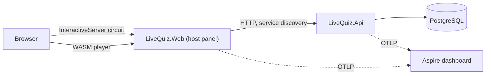

# Architecture

Status: Phase 0 skeleton. Updated as phases land.

Planned additions: Orleans silo in the API (Phase 2), SignalR hub (Phase 2-3), second silo + backplane (Phase 5).
Decisions are recorded in [adr/](adr/).
