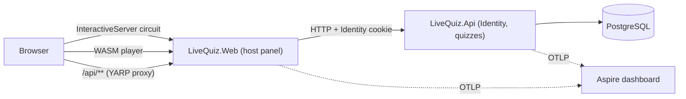

# Architecture

Status: Phase 6 (E2E tests, Docker Compose; ADR 0017). The README has the current diagram. Updated as phases land.

Phase 5 added a second Api instance (its own Orleans silo, membership in Postgres) and an Orleans-based SignalR backplane.
Decisions are recorded in [adr/](adr/).
