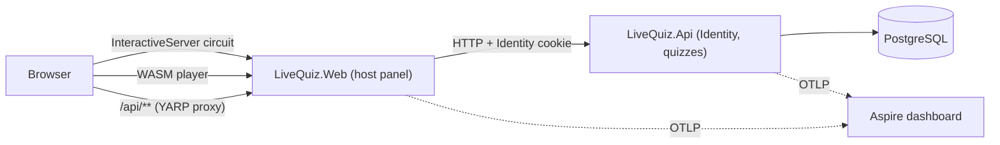

# Architecture

Status: Phase 5 (two silos, SignalR backplane, load test; ADR 0015, 0016, docs/load-test.md). Updated as phases land.

Phase 5 added a second Api instance (its own Orleans silo, membership in Postgres) and an Orleans-based SignalR backplane.
Decisions are recorded in [adr/](adr/).
